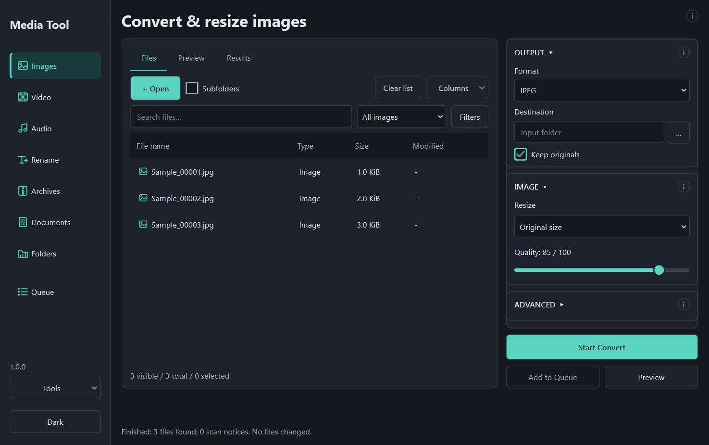

# Media Tool

A local desktop toolbox for converting media, working with PDFs, renaming files and creating archives. Use one workspace for individual files, batches and queued operations.

Built with **Python and PySide6 / Qt Widgets**, with a native desktop interface, light/dark themes and no embedded web browser.



*Actual application screenshot with sample file rows.*

## What it does

| Tool | Features |
| --- | --- |
| Images | Convert to JPEG, PNG or WebP; resize by dimensions or percentage; adjust quality, transparency background and supported metadata. |
| Video | H.264/H.265 in MP4/MKV or VP9 in WebM; resizing; target-size compression; audio/subtitle selection; external subtitles; compatible remux. |
| Audio | Convert or extract audio; trim, split and join; adjust volume or normalize loudness; edit tags and cover artwork. Waveform previews for supported editing tasks. |
| Rename | Sequential, random or separator-cleanup naming; preview changes; undo supported completed renames. |
| Archives | 7z, ZIP and CBZ; combined or per-input archives; compression, exclusions and optional encryption. |
| Documents | PDF page tools; images/PDF conversion; text extraction; lossless cleanup or JPEG image compression; metadata/passwords; optional OCR and Office-to-PDF. |
| Folders | Inspect sizes and contents; flatten one level with preview and supported undo. |
| Queue | Independent jobs or linked tool workflows, with saved history, progress and retry inside the main window. |

Files are processed locally. External tools are needed only for the features listed below.

## License

Copyright (C) 2026 Media Tool contributors. Media Tool is released under
**GNU GPL version 3 or, at your option, any later version**. See [LICENSE](LICENSE).
Third-party components retain their own licenses; see
[third-party notices](THIRD_PARTY_NOTICES.md) and [source information](SOURCES.md).

## Project status

**Version 1.0.0.** The Windows portable build has completed user acceptance testing. See the [release notes](CHANGELOG.md).

The first prebuilt release targets **Windows x64**, tested on Windows 10. Windows 11 and clean-machine behavior have not been independently verified. Earlier source and packaged checks also ran on Debian 13 x64; a Linux binary is not included in this first release. The source requires **Python 3.13**.

## Get started

### Packaged builds

Download `MediaTool-1.0.0-windows-x64.zip` from the **[Releases](https://github.com/alphaq0099/media-tool/releases)** page, extract the **complete application folder**, and launch `MediaTool.exe`. The adjacent `SHA256SUMS.txt` lists release-file checksums.

Keep `_internal` beside the executable. Copying only the executable is not enough. Packaged builds include their Python/Qt runtime; you do not need to install Python or the source project.

### Run from source on Windows

Install Python 3.13, download or clone this repository, and open a terminal in its folder:

```powershell
py -3.13 -m venv .venv
.\.venv\Scripts\python.exe -m pip install -r requirements.txt
.\.venv\Scripts\python.exe run.py
```

After setup, you can also double-click **Start Media Tool.cmd** to launch without a Python console.

### Run from source on Linux

Install Python 3.13 with venv support and the Qt/X11 runtime libraries. See the [Linux setup notes](docs/user-guide.md#linux-setup) for the tested Debian configuration.

```bash
python3.13 -m venv .venv
.venv/bin/python -m pip install -r requirements.txt
.venv/bin/python run.py
```

## Optional external tools

| Dependency | Needed for |
| --- | --- |
| FFmpeg **and** FFprobe | Video and audio operations, including waveform analysis. The installed build must include the selected codecs. |
| 7-Zip command-line tool | 7z output and encrypted archives. Ordinary unencrypted ZIP/CBZ uses the built-in archive implementation. |
| Tesseract and language data | OCR to searchable PDF or text. |
| LibreOffice | DOCX/ODT, XLSX/ODS and PPTX/ODP conversion to PDF. |

Open **Tools → Dependencies** to check availability and open download pages. On Windows, if WinGet is available, select missing tools, accept their agreements and choose **Install selected**. Installation starts only after that action. On Linux, install tools through your distribution or their providers, then check again.

External tools are separate from the base application. Install only those needed for your work. See [dependency setup and troubleshooting](docs/user-guide.md#dependencies).

## Basic use

1. Choose a tool in the sidebar.
2. Use **+ Open** or drag files/folders into the workspace. Enable **Subfolders** when recursive intake is wanted.
3. Choose the task, format and output settings. For most file tools, highlighted rows are used when selected; otherwise visible rows are used.
4. Choose **Preview** to inspect the plan, start directly, or add the operation to Queue.
5. Follow the current file, stage and progress in **Results**. Finished jobs remain available in Queue's **History**.

**Files**, **Preview** and **Results** separate inputs, planning and execution. Help is available through **(i)** buttons. The theme toggle is at the bottom of the sidebar.

Queue can link operations such as **MKV → MP4 → Rename → 7z**. Each step uses the preceding step's verified outputs. See [Queue and workflows](docs/user-guide.md#queue-and-workflows).

## File handling and limitations

- Conversion keeps originals by default. Where offered, disabling **Keep originals** requests moving them to the Recycle Bin/Trash after verified output; failed cleanup preserves them. Rename and flatten are move operations.
- Existing outputs are skipped or given unique names according to the chosen policy. Review previews before applying filesystem changes.
- Video quality and speed are separate settings. A quality preset does not preserve source bitrate or guarantee file size. Target-size mode supports H.264/H.265 in MP4/MKV.
- Animated/multipage image processing and several advanced video inputs, including HDR and interlaced video, are unsupported by the current conversion path.
- Text extraction needs an existing PDF text layer. Scans need OCR. OCR accuracy and Office layout depend on source quality, languages, fonts and external tools.
- Cancellation, retry and undo have operation-specific limits. Conversion is not universally undoable, and retry may restart the current file.

Read the **[user guide](docs/user-guide.md)** for task instructions, formats, passwords, recovery and common errors.

## Development and builds

Install `requirements-dev.txt` in the same virtual environment for tests and packaging.

Windows:

```powershell
.\.venv\Scripts\python.exe -m pip install -r requirements-dev.txt
.\.venv\Scripts\python.exe -m pytest -q
.\.venv\Scripts\python.exe -m PyInstaller --noconfirm MediaTool.spec
```

Linux:

```bash
.venv/bin/python -m pip install -r requirements-dev.txt
QT_QPA_PLATFORM=offscreen .venv/bin/python -m pytest -q
.venv/bin/python -m PyInstaller --noconfirm MediaTool.spec
```

Linux builds need `binutils` for symbol stripping. Output is `dist/MediaTool/`; distribute the entire directory. Build and test on the target operating system. Third-party notices included with a package are under `_internal/licenses` and component metadata.

For support, select a job in **Queue → History → Tools → Export support report**. This exports technical versions, allowlisted settings and outcomes, without filenames, paths, passwords, metadata or free-form messages. **Save report** exports the detailed job record and can contain private paths; review it before sharing. See [support instructions](SUPPORT.md).
